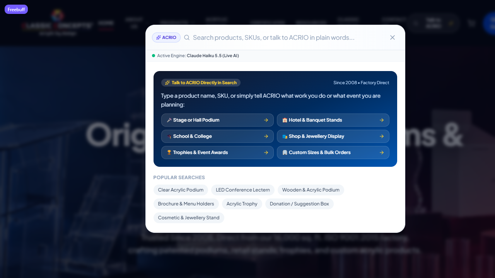
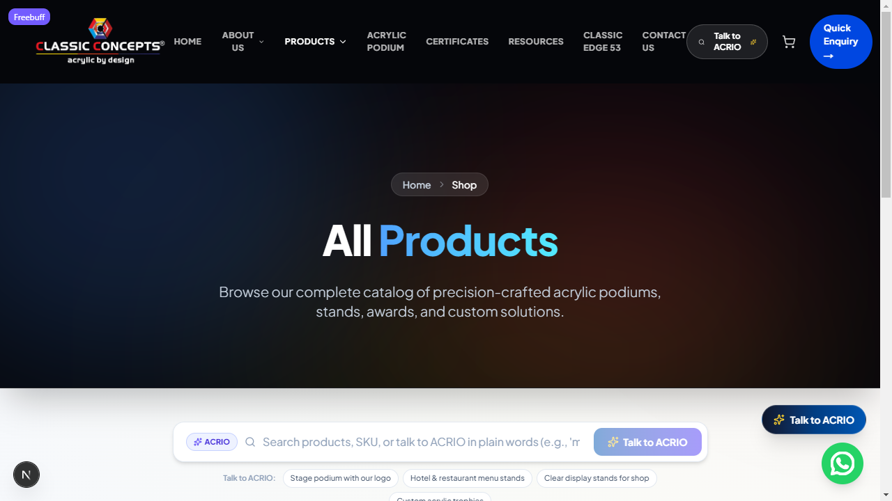
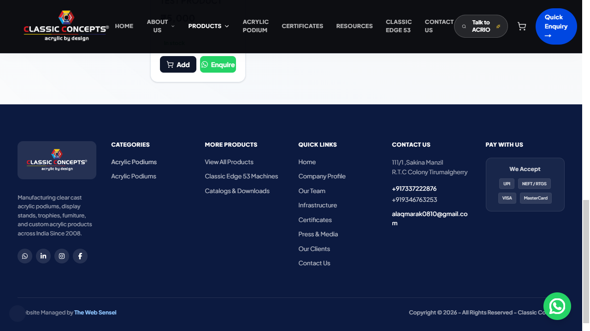
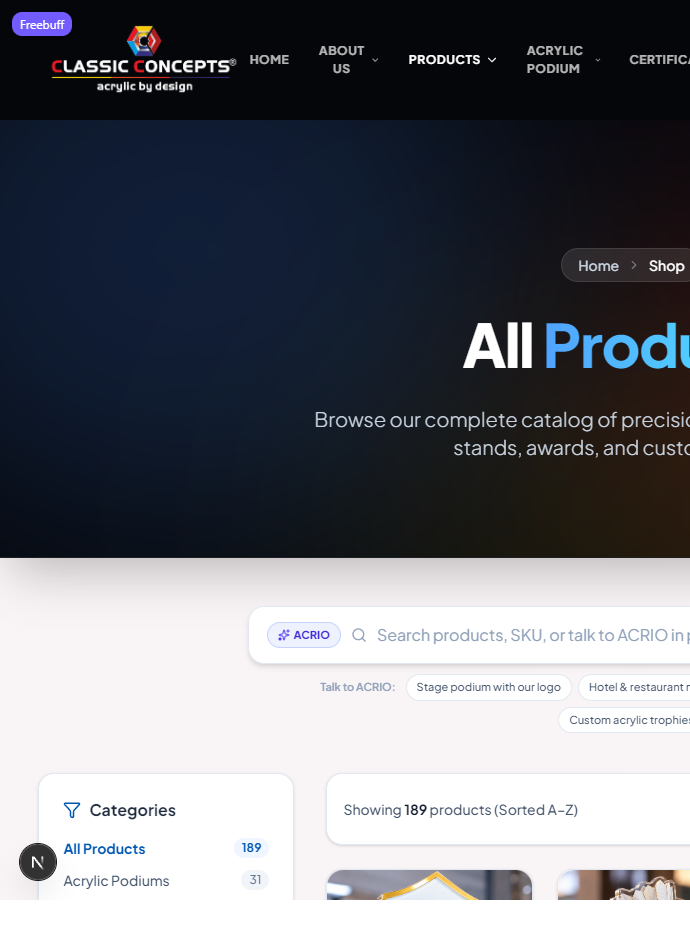
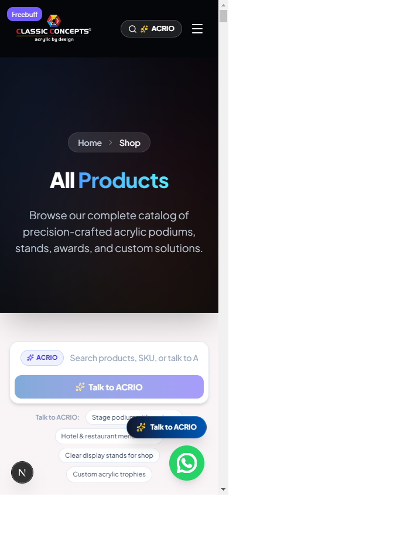
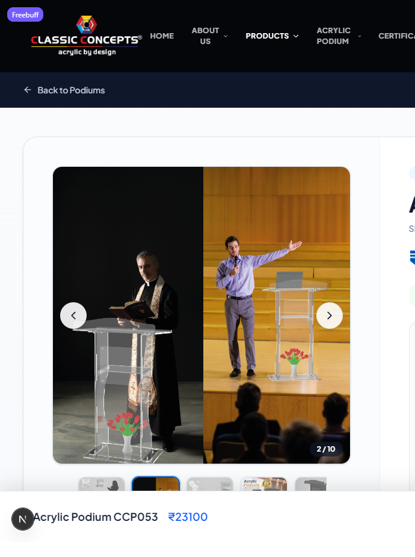
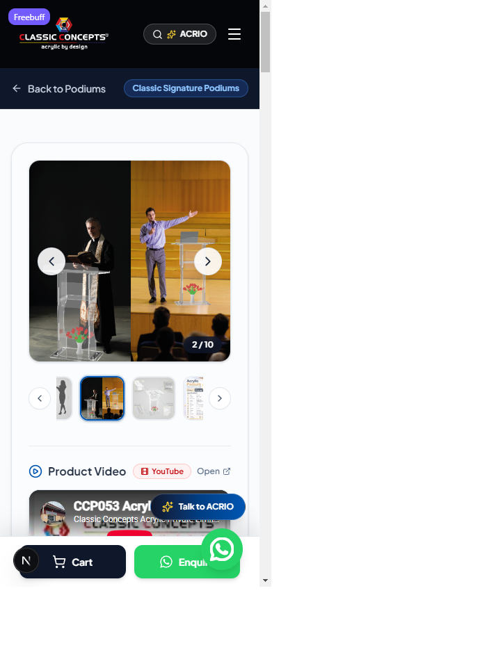
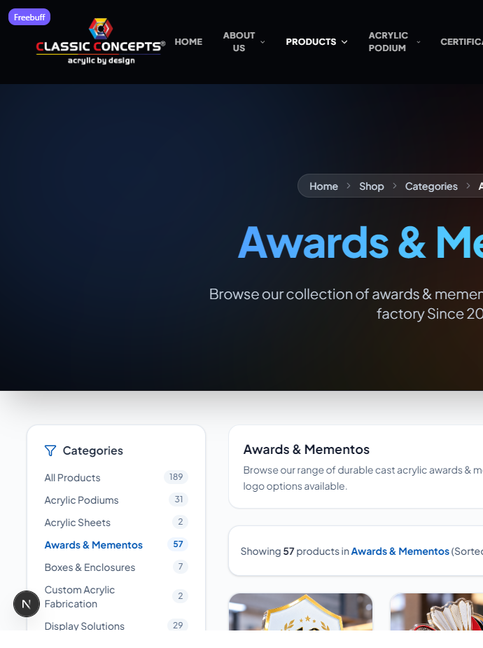
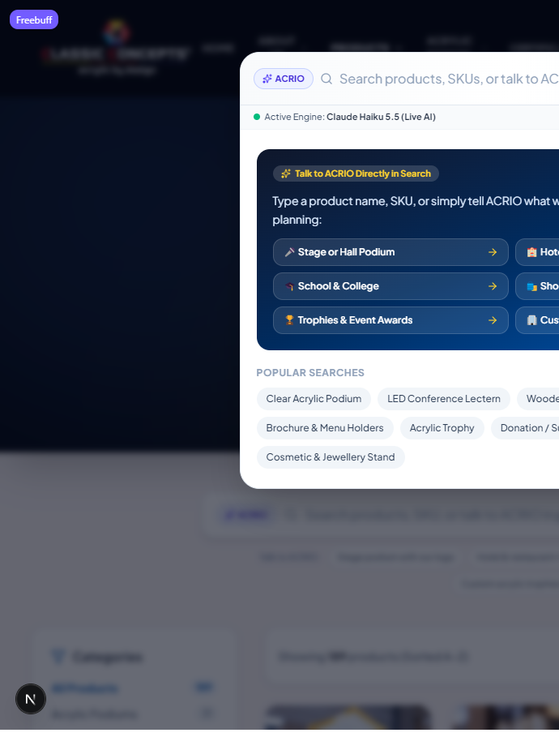

# Classic Concepts: Design, Brand and Visual Audit

**Subject:** classicconcepts.in (Next.js 16, Tailwind 4, Plus Jakarta Sans, 215 source files)
**Audit date:** 13 November 2026. **Pass 2 added 14 November 2026** now that the catalogue holds 189 real products. Start at section 19 for the current score (3.4 / 10) and the catalogue layer findings.
**Scope:** design only. Visual language, brand, layout, typography, colour, components, page-by-page art direction, imagery, motion, marketing presentation, and AI-generated design tells. Security and code are covered separately in `freebuff_audit.md`.
**Method:** source review of every public page and component, quantitative sweeps of the design tokens actually used, live render at 1280 px on the home, shop and footer, plus current published guidance on manufacturing-site design and AI design tells.

**Evidence note (pass 1):** the local database held a demo set (records literally named "TEST", one product, no client logos, no online platforms), so catalogue density was judged from the layout and templates. Every finding about the design system, header, footer, colour, type and patterns holds regardless of data. Pass 2 replaces this caveat with real measurements from 189 products.

---

## 1. The one-line verdict

The site is **well engineered and visually busy in the wrong places**. It reads as a modern startup landing page with acrylic products in it, not as a 16,000 sq ft factory that institutions trust with a ₹40,000 stage podium and a 200-unit rollout. The visual language actively fights the positioning: gradient text, glass badges, floating blobs and pastel icon boxes signal "software startup", while the business needs to signal "precision, capacity, and proof".

Three things drive most of the gap:

1. **No visual identity of its own.** The brand colour is present everywhere (`#0056b3`, 578 uses) but the *decoration* comes from a default gradient-and-glass kit. Cover the logo and this page could belong to any acrylic reseller.
2. **The hierarchy is decorative rather than informational.** 237 uppercase label styles, 25 gradient headlines, 246 full-radius pills, 16 glow blobs. Almost nothing on the page ranks information by importance; everything is emphasised, so nothing is.
3. **Proof is missing or undermined.** No products on the homepage, no prices, no testimonials, no case studies, a Gmail address in the footer, a "VISA / MasterCard" badge for a card gateway that does not exist, and placeholder social links.

---

## 2. Design scorecard

| Dimension | Score | Comment |
|---|---|---|
| Brand distinctiveness | 3 / 10 | Could be swapped with a competitor's site without noticing. |
| Visual hierarchy | 4 / 10 | Hero is loud, catalogue is invisible, every section shouts at the same volume. |
| Typography | 4 / 10 | One family at 816 bold and 138 uses of 11 px. No scale discipline. |
| Colour system | 5 / 10 | Correct brand colours exist, then get diluted by off-brand purple and three blues. |
| Layout and grid | 4 / 10 | No max width, 120 px header, items wrapping, footer bottom bar clipped. |
| Component craft | 5 / 10 | Cards and buttons are tidy individually, inconsistent as a set. |
| Imagery | 3 / 10 | AI/render hero and stock-style placeholders instead of real factory and installs. |
| Conversion design | 3 / 10 | No products or prices on home, no RFQ on product pages, competing CTAs. |
| Accessibility (visual) | 4 / 10 | 9-11 px text widely used, contrast failures on small blue and slate-400 text. |
| Motion and restraint | 4 / 10 | Blur blobs, hover scale, marquee, dead animation classes. |
| **Overall** | **4.0 / 10** | Competent build, unfinished design direction. |

---

## 3. Screenshots reviewed

### Homepage, first screen (1280 px)

### Shop page, first screen

### Footer

What these three frames already show:

- The header is 120 px tall and its nav labels wrap onto two lines ("ABOUT US", "ACRYLIC PODIUM", "CLASSIC EDGE 53", "CONTACT US"), while the "Quick Enquiry" button collapses into a circle with wrapped text at the right edge.
- The hero headline uses a blue to purple to pink gradient (`from-[#60a5fa] via-[#a78bfa] to-[#f43f5e]`), with a pill badge above it and four glass badges below it.
- The shop page title repeats the same gradient treatment, on the same dark blurred backdrop, as every other page.
- The footer's bottom bar is clipped at both edges ("bsite Managed by The Web Sensei", "Classic Co..."), and "Acrylic Podiums" is listed twice in Categories.

---

## 4. Brand and positioning, as expressed visually

### 4.1 The identity is split between "shop" and "factory"

Evidence in one screen: the logo tagline is **"acrylic by design"**, the header CTA is **"Quick Enquiry"**, the hero primary button is **"Explore Collection"**, and the footer sells **"Pay With Us"** with UPI and card badges. Meanwhile the copy says **"16,000 sq. ft. ISO 9001:2015 factory"** and the industry is institutional procurement.

"Explore Collection" and "Pay With Us" are retail vocabulary. A procurement manager at a hospital chain is not browsing a collection; they are validating a supplier. The visual system should read like a capability brochure, not a boutique.

**Direction:** keep the red and blue, drop the fashion language. Logo tagline options: "Acrylic manufacturing since 2008", "Made in Secunderabad since 2008", or remove the tagline entirely and let the wordmark breathe. Primary CTA sitewide: **"Get a quote"**. Secondary: **"Talk to our team"**. Retire "Explore Collection", "Shop Podiums", "Add", "Pay With Us".

### 4.2 The homepage never shows the product

In the live render the homepage contains **zero product links** and no prices. The sequence is hero, about, "what are you looking to improve?", industries, why choose us, how we do it, final CTA. For a manufacturer with a 188-item catalogue and 27 podium models, this is the single biggest commercial design failure. Published guidance for manufacturing sites is consistent on this: the first screen must say what you make, who for, why you, and one next step, and products or capabilities must be reachable immediately (see sources 6 to 9 in section 14).

**Fix:** insert a "Shop by product family" band directly under the hero, then "Best-selling podiums" with prices, then "Recent installations". Keep the story sections below.

### 4.3 There is no proof layer

No testimonials anywhere in the codebase (`grep testimonial` returns nothing), no case studies, no named projects, no install photos, no video of the factory floor beyond an embedded "How We Do It" iframe. Published B2B guidance is blunt: at institutional deal sizes, buyers need named clients in matching verticals, specific problems solved, outcomes, and certifications in context, not logos in a footer (source 10).

**Fix:** a proof band on the homepage with three real installations (photo, venue type, city, what was made), plus the ISO certificate number and the 5-year warranty in plain words. Logos stay, but below the proof, smaller, and only with permission.

---

## 5. AI design tells, found and counted

This is the part most likely to cost credibility with a discerning buyer. The patterns below are the current, widely documented fingerprint of generated or template design (sources 1 to 5). This site hits **eleven** of them.

| # | Tell | Found here | Count / location | Verdict |
|---|---|---|---|---|
| 1 | Gradient text in headings | `bg-clip-text` + `bg-gradient-to-r` | **25 places**, 14 of them the identical `from-blue-400 to-cyan-300` | Remove. Use solid white on dark, solid ink on light. |
| 2 | Purple to blue or pink gradient | Hero headline, Clients heading, search modal CTA | `from-[#60a5fa] via-[#a78bfa] to-[#f43f5e]`, `from-red-500 to-purple-600`, `from-indigo-*` | Remove. Purple is not in the brand. |
| 3 | Blurred colour blobs behind sections | `blur-[100px]` to `blur-[150px]` circles | **16 instances** across home, about, contact, PageHeader | Remove or reduce to one subtle scrim. |
| 4 | Glassmorphism panels | Hero badges, breadcrumb pill, search modal | `bg-black/45 backdrop-blur-xl`, `bg-white/10 backdrop-blur-md` | Keep at most one usage (the modal), drop the rest. |
| 5 | Pill badge floating above the headline | "MANUFACTURING IN INDIA SINCE 2008" | Every page header | Replace with a plain kicker line or move to a trust strip. |
| 6 | Uppercase eyebrow label on every section | "WHO WE ARE", "WHY CHOOSE US", "HOW WE DO IT?", "AVAILABLE ON" | **237 uppercase tracking styles** | Keep eyebrows only where they add structure, max 3 per page. |
| 7 | One font for everything, always bold | Plus Jakarta Sans only | `font-bold` **816**, `font-extrabold` **161**, one family | Add a second face for data and specs, and reduce weights. |
| 8 | Three equal feature cards with thin line icons | Why Choose Us (3), podium trust strip (3 pastel boxes) | Home, podiums | Replace with one strong image plus a short list. |
| 9 | Pastel trio boxes (blue / green / amber) | Podiums trust strip | `bg-blue-50`, `bg-emerald-50`, `bg-amber-50` | Use one neutral card with dividers. |
| 10 | Emoji used as icons | Search modal quick prompts (🗣️ 🏨 🏫 💼 🛍️ 🏆 📐) | `GlobalSearchModal` quick chips | Replace with the existing Lucide set. Also remove from email subjects. |
| 11 | Centered everything | Hero, every page header, every section heading | Sitewide | Left align most content. Centering is the safe default of generated layouts. |

Two more finishing tells that are easy wins:

- **Dead animation classes.** `animate-blob`, `animation-delay-2000`, `animation-delay-4000` are applied in `Clients.tsx` and `contact/page.tsx`, but `globals.css` defines only the marquee keyframes. The "animated gradient blobs" are static, and the class names are noise.
- **Starter scaffolding still in `public/`.** `next.svg`, `vercel.svg`, `file.svg`, `globe.svg`, `window.svg` are unused Next.js defaults, and three unused hero variants (`hero-podium.png`, `hero-neon-podium.png`, `hero-neon-wide.png`, `hero-generated-podium.png`) sit beside the live one. Remove them; it also saves about 2.2 MB.

What the tells cost: recognised AI or template design reads as "new, small, or not paying attention" even when the business is none of those (source 3). For a factory selling trust, that is the expensive kind of mistake.

---

## 6. Colour

### 6.1 What is actually in the code

| Colour | Uses | Role it is playing |
|---|---|---|
| `#0056b3` | **578** | Primary blue, links, buttons, icons, sidebar active states |
| `#e31837` | 41 | Accent red, underlines, badges, one CTA |
| `#0c1a40` | 20 | Footer navy |
| `#3b82f6` | 18 | Decorative blue in gradients, eyebrows, hover states |
| `#05060a` | 7 | Header and hero black |
| `#0047e1` | 3 | Header CTA blue, different from the primary |
| `#60a5fa` / `#a78bfa` / `#f43f5e` | 6 / 3 / 3 | Hero gradient (purple and pink) |
| `#ffdf00` | 3 | Yellow glow blob |
| `#1a295c`, `#0b1426`, `#0d1f4d` | 6 / 4 / 1 | Extra navies |

So the palette is not "blue and red". It is three blues, four navies, two reds, a purple, a pink and a yellow, all used decoratively.

**Problems this creates:**
- The header CTA (`#0047e1`) and the contact submit (`#0056b3`) are visibly different blues one scroll apart.
- The hero's purple and pink belong to no brand asset and no product photo. They are the exact palette the AI-tell literature names first.
- Red is used for emphasis (`w-16 h-1` underlines, badges) and for primary action (bottom CTA), so it carries no consistent meaning.
- `#e31837` on `#0056b3` measures **1.49:1**. Never place brand red on brand blue.

### 6.2 Proposed palette

Keep the two brand colours, then make everything else neutral and quiet.

| Token | Hex | Use |
|---|---|---|
| `brand-blue` | `#0056b3` | Links, primary buttons, active states |
| `brand-blue-deep` | `#003d80` | Hover, footer headings, dark sections |
| `brand-red` | `#e31837` | One action per screen, small emphasis rules only |
| `ink` | `#0f172a` | Headings |
| `body` | `#334155` | Body copy |
| `muted` | `#64748b` | Secondary copy (4.76:1 on white, passes) |
| `line` | `#e2e8f0` | Borders and dividers |
| `surface` | `#f8fafc` | Section backgrounds |
| `paper` | `#ffffff` | Cards |
| `navy` | `#0c1a40` | Dark sections and footer (single navy, not four) |

Rules:
1. One primary action colour per page, blue. Red only for a genuine alert or a single high-emphasis CTA.
2. No gradients on text. Ever.
3. No purple, no pink, no yellow outside product photography.
4. Dark sections use `navy`, not `#05060A`, so header, hero and footer feel like one material.
5. Tint backgrounds only from `surface` and `brand-blue` at 4 to 6 percent. Not blue, green and amber pastels.

---

## 7. Typography

### 7.1 Diagnosis

- **One family:** Plus Jakarta Sans at every size and weight. It is a good geometric sans, and it is also the default of the current scaffold generation, which is why it reads generic.
- **Weight inflation:** 816 `font-bold`, 217 `font-semibold`, 161 `font-extrabold`. When half the page is bold, bold stops meaning anything. The hero H1, subtitle, section titles, eyebrows, card titles and prices are all heavy.
- **Micro type epidemic:** `text-[11px]` **138 times**, `text-[10px]` **42 times**, `text-[10.5px]` **16 times**, `text-[9px]` 5 times. A procurement manager reading a spec on a laptop at 125 percent zoom should not need to squint.
- **No scale:** sizes are ad hoc (`text-[17px]`, `text-[15px]`, `text-[13px]`, `text-[12px]`), so the page has no rhythm to scan.
- **Headings and body too close in some blocks:** section headings at `text-2xl` with 14 to 16 px body beneath them do not rank.

### 7.2 Proposed type system

Add a second family for technical content. A clean pairing that suits a manufacturer: keep **Plus Jakarta Sans** for headings and UI, add **IBM Plex Sans** (or Inter Tight) for body and a tabular figure face for specs and prices. Plex carries an engineering tone and has excellent numerals. If one family is mandatory, use Plus Jakarta Sans and do the discipline through scale and weight alone.

| Role | Size / line height | Weight | Usage |
|---|---|---|---|
| Display | 56 / 60 desktop, 36 / 40 mobile | 700 | Homepage H1 only |
| H1 | 40 / 48, 32 / 38 mobile | 700 | Page titles |
| H2 | 30 / 38 | 700 | Section titles |
| H3 | 20 / 28 | 600 | Card titles, subsections |
| Body L | 18 / 30 | 400 | Lead paragraphs |
| Body | 16 / 26 | 400 | Default copy. Minimum for all prose. |
| Small | 14 / 22 | 500 | Labels, meta, captions |
| Micro | 12 / 16 | 600 | Badges and legal only, uppercase, tracked |
| Spec | 15 / 22, tabular numerals | 500 | Dimensions, prices, SKUs |

Rules: 12 px is the absolute floor. No `text-[10px]`, no `text-[9px]`. Headings 700 maximum (reserve 800 for the display line only). Body never bolder than 500. Prices and dimensions use tabular numerals so columns align.

---

## 8. Layout, grid and spacing

### 8.1 Container

`globals.css` overrides `.container` with `max-width: 100% !important` and a `clamp()` padding. Result: no page has a designed maximum width, so on a wide screen lines run very long, and the layout never resolves into a deliberate grid. Worst case, it also breaks the footer, which is clipped at both edges in the screenshot.

**Fix:** container max width 1240 px, padding 20 px mobile / 32 px tablet / 48 px desktop. Remove the `!important` override.

### 8.2 Header

Measured live: **120 px tall**, nine destinations, nav labels wrapping to two lines, CTA collapsing into a circle. That is the most conspicuous craft failure on the site because it appears on every page.

**Spec:**
- Height 72 px desktop, 64 px mobile.
- Six destinations maximum: Products, Industries, Podiums, Custom work, Projects, Contact.
- 14 px sentence case or 13 px uppercase with `tracking-[0.08em]`, `whitespace-nowrap` (wrapping is the bug).
- One primary CTA: "Get a quote", 40 px tall, solid blue, `rounded-lg` not `rounded-full`.
- Search becomes an icon that opens the unified modal. Keep the ⌘K hint.
- At 1024 to 1200 px, move Industries and Projects into the Products panel rather than shrinking.

### 8.3 Section rhythm

Currently `py-12`, `py-16`, `py-20`, `py-24` appear with no logic, and section headings vary between 24, 30, 36 and 48 px. Standardise:

- Section padding: 96 px desktop / 64 px tablet / 48 px mobile.
- Section header block: eyebrow (optional) 12 px, title 30 to 38 px, one-sentence intro 18 px, then 32 px gap to content.
- Max two centred section headers per page. Left align the rest.

### 8.4 Radii and shadows

`rounded-xl` 481, `rounded-full` 246, `rounded-lg` 224, `rounded-2xl` 187, `rounded-3xl` 40, plus `rounded-[2rem]`, `rounded-[1.5rem]`, `rounded-xs`, `rounded-sm`. Eleven shadow variants, including custom `shadow-soft` and `shadow-hover`.

**Fix:** four radii only (4 px inputs, 8 px buttons, 12 px cards, 999 px chips) and two shadows (one resting `0 1px 2px rgba(15,23,42,.06)`, one raised `0 12px 32px rgba(15,23,42,.10)`). If a card needs a stronger shadow to look separated, the problem is the border or the background, not the shadow.

---

## 9. Components

### 9.1 Buttons

Three different primary styles compete: header `bg-[#0047e1] rounded-full`, hero `bg-gradient-to-r from-[#0047e1] to-[#3b82f6] rounded-full`, bottom CTA `bg-[#e31837] rounded-full`, plus `AboutSnippet` outline pill, plus `ProductCard` dark `rounded-lg` "Add" with green WhatsApp "Enquire". Users cannot learn what blue, red, dark and green each mean.

**Spec:**
| Variant | Look | Use |
|---|---|---|
| Primary | Solid `brand-blue`, white text, `rounded-lg`, 44 px tall | One per screen: quote or enquire |
| Secondary | White, 1 px `line` border, ink text | View details, browse |
| Tertiary | Text + arrow, no fill | Inline links |
| WhatsApp | Solid `#25D366` | Only the WhatsApp shortcut, always with the icon |
| Destructive | Red text, no fill | Admin delete only |

Remove full-radius from buttons. Reserve pills for chips and filters. For the B2B market, squared corners read as machinery and precision; pills read as consumer app.

### 9.2 Cards

- `ProductCard` is a white card with a 1 px border and a shadow, and the whole card is a link with buttons inside. Visually it works; semantically and for keyboard it does not (nested interactive elements). Redesign: image on `surface`, title, model code, price, then two buttons as siblings.
- `CategoryCard` is 288 px tall with the image at 208 px. Fine. But category names are blue by default (`text-[#0056b3]`) which makes a grid of 12 cards look like a link list. Make names ink, and let hover shift to blue.
- Card radii drift between `rounded-2xl` and `rounded-3xl` in the same grid in some pages.

### 9.3 Badges

Red discount pill, green "In stock", orange made-to-order, blue subcategory, amber "Quick Guide", indigo AI chips, plus the IP "i" popover. Six badge systems. Reduce to two: **status** (neutral outline) and **emphasis** (solid red, one per card maximum). Delete the loud red discount pills on podiums and replace with a quiet "Our price" line, as your own strategy document recommends.

### 9.4 Forms

Contact and checkout inputs are `bg-slate-50` with `rounded-xl`, 2 px focus ring. They are clean. Three problems:
- Labels are bold 14 px, while placeholders repeat the label ("Full Name *" then "John Doe"). Remove placeholders that duplicate labels.
- Required fields are marked with a literal `*` in the label. Use `required` plus a single line above the form: "Fields marked * are required."
- No file upload on the contact form even though custom fabrication is the highest-value enquiry. Add a drawing/photo drop zone. It is the single highest-impact form change available.

### 9.5 Footer

Live issues, all visible in the screenshot:
- "Acrylic Podiums" appears twice in Categories.
- Contact block shows `alaqmarak0810@gmail.com`, a personal Gmail, wrapped mid-word ("gmail.co / m").
- Address is "111/1, Sakina Manzil, R.T.C Colony Tirumalgherry" while `/about` and `/contact` describe the Secunderabad factory. Inconsistent NAP data hurts both trust and local SEO.
- "We Accept VISA / MasterCard" with no card gateway.
- LinkedIn, Instagram and Facebook icons all link to the bare domains (`https://linkedin.com`), not your profiles.
- Bottom bar text is clipped at both edges because of the container overflow.
- The copyright line reads "Copyright © 2026 - All Rights Reserved - Classic Concepts" with hyphen punctuation.

**Spec:** four columns (Products, Capabilities, Company, Contact), one column of contact detail with the factory address and `sales@classicconcepts.in`, a compact trust row (ISO 9001:2015 number, GSTIN, "Made in India since 2008"), and a single bottom line with the legal name and year. Remove the vendor credit or move it to a `/credits` link.

---

## 10. Page-by-page art direction

### Homepage

Current: hero (1.5 screens) → about card between four certificate tiles → problem statements carousel → industries carousel → why choose us on black → how we do it + video → CTA. No products, no prices, no proof, no locations.

Proposed order, 9 blocks:
1. **Hero:** real photograph of a finished podium on a stage, not a render montage. Left-aligned. H1 that states the business: "Acrylic podiums and custom displays, made in our 16,000 sq ft Secunderabad factory." One line of proof. Two buttons: "Get a quote" / "Browse podiums". No gradient text, no badge pill, no glass tiles.
2. **Capability strip:** five plain facts in a row with hairline dividers. Since 2008 · 16,000 sq ft · ISO 9001:2015 · 27 podium models · Pan-India + export. This replaces the four "PREMIUM / PRECISION / CUSTOM / MADE IN" badges, which say nothing.
3. **Shop by family:** 8 to 12 categories, 4:3 photography on `surface`, name, one line, count. This is the missing commercial block.
4. **Best-selling podiums:** 4 to 6 cards with model code and price, plus "Compare ranges" and "Help me choose".
5. **Custom fabrication spotlight:** split block, sketch or CAD on one side, finished piece on the other, with the WhatsApp drawing handoff.
6. **Industries:** 6 sectors with environment photos, not icons.
7. **Proof:** three installations with venue, city, and what was made, plus two short quotes with names and roles.
8. **Factory:** one wide shop-floor photo or a 30-second loop, with three numbers (machines, team, capacity).
9. **Final CTA:** quote form anchor with phone, WhatsApp and response-time promise.

### Shop and category pages

- The page header is about 410 px tall for a breadcrumb, a gradient title and one line. Cut it to 200 px, left aligned, with the title in ink on paper, and put the product count and filter chips in the same band.
- The ACRIO search bar is the loudest element above the catalogue, with a purple-blue gradient button. Demote it: 48 px tall, white, one primary icon, no gradient, sitting beside the category title.
- Add same-page filter pills (All, Counter, Floor, QR stands, Brochure holders) as specified in `changesrequired.md`; a 12-item sidebar plus a 12-item footer plus a dropdown gives three ways to do the same thing.
- Product grid: 2 columns mobile, 3 at 768, 4 at 1200, 24 px gutters, consistent card height, price always visible (currently hidden below `sm`).
- Add an empty state with three nearest categories and the WhatsApp shortcut. Right now a zero-result search shows an empty grid.

### Podiums

This should be the flagship page and it currently opens with a dense white card containing three pastel trust boxes and a collapsible comparison table, above a sidebar filter and a search bar. Four blocks before the first podium.

- Lead with the three ranges as three image tiles (Essential, Signature, Premium) with "from ₹" pricing and one line of who it suits.
- Put "Registered design" and warranty as a single quiet line under the tiles, not three boxes.
- Move the comparison table below the first product row, and style it as a spec table in the new type system.
- Replace the red discount pills with "Our price" and the struck MRP in `muted`.
- Add the comparison tool (tick up to 3) because 27 models with no comparison is a decision dead end.

### Product detail

- "What is it?" in one sentence, then 4 to 6 bullets, then specs table, then lead time/shipping/warranty strip, then related products. The current page leads with gallery and price, and the reassurance sits far below.
- Prices: show "₹23,100" plus "MRP ₹42,000" in `muted` strikethrough, no red percentage.
- Replace "In stock" with "Ready to dispatch in 3 to 5 working days" or "Made to order, 10 to 14 days".
- Primary CTA "Get a quote for this podium", secondary "WhatsApp us". The cart "Add" is a retail pattern that adds friction and no revenue here.
- Add an RFQ form with the model pre-filled and a drawing upload.

### About, infrastructure, clients, certificates

- Replace the repeated dark gradient page header with a photographic header per page (factory floor for infrastructure, team for team, certificate wall for certificates).
- `/about` currently claims "market leader", "over two decades" and "patented designs" in the same screen. Visually this is where credibility is won or lost; accurate, specific, dated facts beat superlatives.
- `/about/clients` should group logos by sector with a line of context per group, not a flat wall.

### Contact and cart

- Contact: four action cards (call, WhatsApp, email, visit) as your spec says. Currently a two-column layout where the map is below the fold and the team section repeats what `/about/team` does.
- Cart: rename to "Quote list" everywhere. "Request Checkout" with a delivery address and an "Estimated Total" promises a checkout that does not exist, which is worse than no cart at all.
- Both forms need the privacy line and, on contact, the drawing upload.

### Admin

Not the focus of a marketing audit, but two visual notes: the dashboard is a separate visual language (slate and indigo, different radii) and it uses the same `#0056b3` for a different purpose; and the inline-edit dock plus hover pencils mean an admin's screenshots sent to a client will contain editing chrome. Add a "presentation mode" toggle that hides all edit affordances.

---

## 11. Imagery and graphic design

### 11.1 Current assets

| Asset | Size | Problem |
|---|---|---|
| `hero.png` | 976 KB | AI/render montage of floating acrylic shapes. Reads as a stock 3D render, not a factory. |
| `short-logo.png` | 776 KB | A 776 KB favicon/apple icon. Absurd for a 32 px glyph. |
| `press-clipping-2.png` | 1.1 MB | Unoptimised scan. |
| `butterfly-table.png` | 600 KB | Product cutout, used as the about image. |
| Four unused hero variants | ~2.2 MB | Dead files. |
| `next.svg`, `vercel.svg`, `window.svg`, `file.svg`, `globe.svg` | small | Scaffolding leftovers. |

### 11.2 Direction

The category convention is clear and consistent across published manufacturing design guidance: **real photography beats renders**, and a half-day shoot of the shop floor, machines, finished pieces and team is the highest-return visual investment available (sources 3, 7, 8, 9).

Shot list to commission (one day, one photographer):
1. **Hero:** a finished Signature podium on a real stage with an audience blurred behind, or the podium in front of a lit auditorium.
2. **Factory wide:** 3 to 4 angles showing the 16,000 sq ft floor, racks of acrylic sheet, the laser and CNC in operation.
3. **Process close-ups:** laser cutting sparks or beam, edge polishing with the flame, bending, UV printing a logo.
4. **Hands and people:** one operator at a machine, one person checking an edge. Faces build trust.
5. **Product on white:** consistent lighting and angle for all 27 podiums and the top 40 products. This fixes catalogue inconsistency more than any CSS change.
6. **Installs:** church pulpit, college auditorium, hotel banquet, corporate reception, hospital reception, retail counter. Six environments.
7. **Packaging:** foam wrap and wooden crate, because "safe crated delivery" is a claim buyers test.

Treatment: neutral colour grading, no purple or teal lighting, no floating objects. If renders are unavoidable for new models, match the lighting of the photography so the grid does not look pasted together.

Logo: the current mark is a red/blue geometric icon plus "CLASSIC CONCEPTS" plus "acrylic by design". At 120 px header height the wordmark is fighting the tagline. Simplify to the icon plus wordmark at one size, drop the tagline from the header, and produce a proper favicon set (16, 32, 180, 512). Also produce a white and single-colour version for dark backgrounds.

---

## 12. Motion and interaction

- Motion is almost absent as a system: `framer-motion` is installed but used in one component (`ProductGallery`). Everything else is CSS hover.
- `animate-pulse` on the hero blobs and the live dot, `animate-marquee` on clients, `hover:-translate-y-1` on cards, `hover:scale-105` on logos, `group-hover:translate-x-1` on arrows. Individually fine, collectively arbitrary.
- Proposed rule set: 150 ms for hover and focus, 250 ms for panels, 300 ms maximum for anything else, `ease-out` only, no translation greater than 4 px, no scale above 1.02, and no looping ambient animation (pulse, float, marquee) except the client logo strip, which should pause on hover and respect `prefers-reduced-motion`.
- Add `@media (prefers-reduced-motion: reduce)` to disable marquee, pulses and scroll effects.

---

## 13. Visual accessibility

Measured with the WCAG relative luminance formula:

| Pair | Ratio | Verdict |
|---|---|---|
| `#3b82f6` on white | **3.68:1** | Fails for the 10 px "WHO WE ARE" style eyebrows |
| `#94a3b8` (slate-400) on white | **2.56:1** | Fails wherever used, including product meta |
| `#64748b` on white | 4.76:1 | Passes |
| `#0056b3` on white | 7.04:1 | Passes |
| `#e31837` on white | 4.72:1 | Passes, but only just, so never use at 11 px |
| white at 60% on `#0c1a40` | 6.74:1 | Passes |
| white at 50% on `#0c1a40` | 5.12:1 | Passes |
| `#e31837` on `#0056b3` | **1.49:1** | Never pair |

Also:
- 9, 10 and 10.5 px text is used 63 times. Raise to 12 px minimum.
- Focus states exist on inputs but not on header, footer or card links. Add a visible 2 px `brand-blue` ring with 2 px offset on `:focus-visible`.
- The product IP popover is hover and click, fine, but the desktop "View Details" overlay is hover only and `pointer-events-none`, so it does not exist for keyboard or touch.
- The header CTA and nav are effectively unreadable at 1024 to 1180 px because labels wrap. That is a visual accessibility failure as much as a layout bug.
- Images: the hero background carries alt text "Classic Concepts Acrylic Product Showcase" but is decorative, so it should be `alt=""`; the map iframe has no `title`.

---

## 14. Marketing presentation

1. **Say what you make in five seconds.** The current H1 is "Original Acrylic Podiums & Custom Displays Since 2008". It names products and a date but not the capability or the customer. Try: "Acrylic podiums, displays and custom fabrication, made in our Secunderabad factory since 2008." Capability, place, proof.
2. **One primary action.** Today: Quick Enquiry, Talk to ACRIO, Explore Collection, Shop Podiums, Add, Enquire, Get a Quote Today, Request Checkout, Request Payment Link. Nine labels for two intents. Standardise on "Get a quote" and "WhatsApp".
3. **Price logic.** Mixing "Price on Request", struck MRP, red discount pills and hidden mobile prices makes the business look unsure whether it sells online. For B2B: show a starting price on every card, explain what changes it ("depends on size, thickness, quantity"), and keep the quote as the conversion.
4. **Proof placement.** Certifications belong next to claims, not on a separate page. The ISO badge is 96 px in an about card; it should be a 16 px inline confirmation beside "16,000 sq ft ISO 9001:2015 factory".
5. **AI assistant presentation.** The panel currently announces "Active Engine: Claude Haiku 5.5 (Live AI)". Customers do not care which model runs, and it makes the brand look like a demo. Rename the surface "Find your product" with an "Ask ACRIO" tab, drop engine labels entirely, replace emoji chips with product photography thumbnails, and remove "Local Catalog Match • AI Key Not Set" from every customer-facing state. The assistant is a good feature presented as an engineering dashboard.
6. **Social proof rhythm.** Clients logo marquee with an unsourced "1000+ Brands Worldwide" is the weakest form of proof. Move to three named installations, two quotes, then a quieter logo strip.
7. **Response promise.** "We reply within 24 working hours" beside every form. The auto-reply email already promises it; the site should too.

---

## 15. Prioritised redesign plan

### Week 1: stop the bleeding (visual only, no new content)

1. Header rebuild: 72 px, six items, no wrapping, one solid CTA (spec in 8.2).
2. Remove gradient text everywhere (25 instances). Solid white on dark, solid ink on light.
3. Remove the purple and pink from the hero, search modal and clients heading. One navy, one blue, one red.
4. Footer fixes: duplicate category, Gmail address, clipped bottom bar, placeholder socials, VISA/MasterCard badges.
5. Type floor: replace every `text-[9px]`, `text-[10px]`, `text-[10.5px]`, `text-[11px]` with 12 px minimum; drop `font-extrabold` to `font-bold` on non-display text.
6. Delete unused hero variants, Next.js starter SVGs, and the dead `animate-blob` classes.

### Weeks 2 and 3: the system

7. Tokens: colour, radius, shadow and spacing per sections 6 and 8. Replace hard-coded hex with tokens.
8. Type scale per 7.2, with tabular numerals for price and specs.
9. Buttons and badges consolidated to the specs in 9.1 and 9.3.
10. Container max width 1240 px, section rhythm standardised.
11. Product card rebuild (valid nesting, price visible on mobile, model code, quiet discount).
12. Shop, category and podium page headers reduced to 200 px and left aligned.
13. ACRIO surface reskin: no gradient, no engine labels, no emoji.

### Weeks 4 to 6: the commercial layout

14. Homepage restructured to the nine blocks, with product families and best sellers above the story.
15. Podiums range tiles, comparison table moved down, comparison tool.
16. Product detail reorder plus RFQ form with drawing upload.
17. Contact action cards, quote-list rename, privacy line under both forms.
18. Proof band: three installations, two quotes, certificate numbers in context.

### Month 2: identity and assets

19. Photo shoot, grading, consistent product cutouts, logo simplification, favicon set.
20. Page-specific photographic headers to replace the repeated dark gradient banner.
21. Motion rules and `prefers-reduced-motion` pass.
22. Accessibility sweep: focus rings, contrast, 12 px floor, iframe title, decorative alt text.

---

## 16. Design QA checklist for future changes

- No gradient text, no purple, no blurred colour blob on a new section.
- One primary button per screen; red used for one emphasis at most.
- All text 12 px or larger; body 16 px; one weight above 700.
- Every card in a grid uses the same radius, border, shadow and image ratio.
- Price visible at every breakpoint.
- Nav bar labels never wrap at 1024, 1180, 1280, 1440.
- Container never exceeds 1240 px; no horizontal overflow at 320, 390, 768, 1024, 1440.
- Every claim on screen has a proof element within one scroll.
- No internal system names, model names, or engine states in customer-facing UI.
- No emoji in customer-facing UI or email subjects.
- Every image has a purpose, a real subject, and a compressed size under 250 KB.

---

## 17. Sources consulted

1. "20 Signs a Website Was Made by AI", SCALR, October 2026. https://scalr.sg/blog/20-signs-a-website-was-made-by-ai
2. "The 'Built with AI' Tell: 12 Signals That Drop Trust", Utsubo, June 2026. https://www.utsubo.com/blog/built-with-ai-trust-signals-2026
3. "How to Spot an AI-Generated Website", Maxiality, October 2026. https://maxiality.com/how-to-spot-an-ai-generated-website/
4. "AI Slop: Why Everything Designed With AI Looks the Same", Designpixil, August 2026. https://designpixil.com/blog/ai-slop-design
5. "How to make your website look less AI-generated", Gabriel Hidalgo, October 2026. https://www.gabrielhidalgo.design/blog/make-website-look-less-ai-generated
6. "Industrial & Manufacturing Website Design: What to Include", Spotlight Studios, October 2026. https://spotlightstudios.co.uk/news/website-design-for-manufacturers/
7. "Manufacturing Website Design Guide: Build a Site That Converts Buyers", WeCreate, July 2026. https://www.wecreate.com/insights/manufacturing-websites-that-convert-buyers
8. "The 3 Key Elements of Manufacturing Website Design", DDA Corp, October 2026. https://www.ddacorp.com/resources/3-key-elements-of-manufacturing-website-design/
9. "Website Design for Manufacturers: 8-Point Checklist", Alves Brands, November 2026. https://alvesbrands.com/guides/website-design-for-manufacturers
10. "Manufacturing website design: a guide for industrial B2B", Qream, June 2026. https://theqream.com/blog/post/manufacturing-website-design
11. "Drive B2B Sales with Modern Industrial Website Design", Shopify Enterprise. https://www.shopify.com/enterprise/blog/industrial-website-design
12. WCAG 2.2, Understanding Success Criterion 1.4.3 Contrast (Minimum). https://www.w3.org/WAI/WCAG22/Understanding/contrast-minimum.html

---

## 18. Limits of this review

- Live visual review covered the homepage, the shop page and the footer at 1280 px. Mobile, tablet, product detail, podiums, about and admin were assessed from source and from the accessibility tree, not from screenshots. A device pass is still needed.
- Screenshot capture in this environment repeated the first frame after scrolling, so mid-page sections were judged from markup and rendered text rather than pixels.
- The local database is a demo set (records named "TEST", one product, no clients), so catalogue density and logo marquee judgement is about the template, not your live content. Re-run the visual checks against production data before signing off.
- No user testing, heatmap, or analytics data was available, so conversion claims here follow published practice rather than measured behaviour on this site.
---

# Pass 2: the audit after the catalogue went live

**Second audit date:** 14 November 2026
**Trigger:** the database now holds 189 real products (it held one during pass 1).
**Method:** live render of the shop, category and product pages at 1280 px and 390 px, DOM measurements of every grid and card, direct SQL against `dev.db` for catalogue health, shipped JavaScript and CSS read for the gallery, header, search overlay and page banner, and current published guidance on product list UX. New screenshots are in `audit-shots/04` to `audit-shots/10`.

This pass keeps every finding from pass 1. Nothing in there got better with real products. What changed is that the site now has a catalogue to sell, and the catalogue layer is the weakest part of the design. That layer is what this pass covers.

### Screenshots from this pass

The shop page at 1280 px with all 189 products in one grid. The page continues for 28,273 px below this frame.

The same grid at 390 px. No product is visible on the first screen, and no price is shown on any card at this width.

A product page at 1280 px: composite collage photo, three overlays on the image, and a fixed commerce bar across the bottom.

A product page at 390 px: the ACRIO pill, the WhatsApp button and the enquiry bar all claim the same corner.

The biggest category: 57 products, every one unpriced, with no subcategories to break it up.

## 19. What 189 products changed

A real catalogue turns three soft findings into hard ones. It also exposes new failures that one product could not show.

| Measure | Count | What it means for design |
|---|---|---|
| Products | 189 | Enough to need pagination, sorting and filters. None exist. |
| Categories | 13 | One flat level. Subcategories table is empty (0 rows) even though the UI is built for them. |
| Images | 569 | 3.0 per product on average. 102 products have exactly one. |
| Products with no price | 152 (80%) | Four out of five cards say "Price on Request". The grid has no price signal. |
| Products with no description | 118 (62%) | The product page becomes a photo and a button. |
| Products with no key features | 162 (86%) | The "Key Features" block never renders on most pages. |
| Products with no specifications | 150 (79%) | No dimensions, no material, no weight on most pages. |
| Products with no SKU | 58 | Enquiries cannot be matched to an item. |
| Discount badges in use | 0 | 36 products show a struck-through MRP with no "save X%" label. |
| Stock statuses | 1 ("In stock" on all 189) | The stock badge carries no information. |
| Podiums | 31 | The one category with real pricing (14,999 to 28,600). |
| Products with variants | 36 | 153 products show a "SELECT VARIANT" block that does nothing useful. |
| Names over 50 characters | 46 (17 over 70, longest 122) | Two-line cards cannot hold them, so the grid turns into a text wall. |
| Names containing a code (CCP053) | 28 | Naming switches between a poem and a part number with no rule. |
| Products in Awards & Mementos | 57, all unpriced, all with no description | The biggest category is the emptiest one. |

### Updated scorecard

| Dimension | Pass 1 | Pass 2 | Why it moved |
|---|---|---|---|
| Brand distinctiveness | 3 | 3 | Unchanged. Real products did not add a point of view. |
| Visual hierarchy | 4 | 4 | The listing has no product on the first screen at 1280 or 390. |
| Typography | 4 | 3 | 207 px cards carrying 12 px titles of up to five lines. |
| Colour system | 5 | 5 | Unchanged. |
| Layout and grid | 4 | 2 | A 28,273 px page with 189 cards, no pagination, and a dead 27,000 px filter column. |
| Component craft | 5 | 4 | Cards break at real name lengths, prices vanish on mobile. |
| Imagery | 3 | 2 | 4.18 MB PNGs, composite collage hero shots, square crops of portrait photos. |
| Conversion design | 3 | 2 | 80% of products have no price, 62% have no description, no related products. |
| Accessibility (visual) | 4 | 3 | 29 px tall buttons on mobile, 11 px labels, price hidden at the small breakpoint. |
| Motion and restraint | 4 | 3 | Auto-advancing gallery every 3.5 s, auto-opening search modal over the grid. |
| **Catalogue layer** | not scored | **2.5 / 10** | This is the part customers use. |
| **Overall** | **4.0 / 10** | **3.4 / 10** | The shell held still while the shop grew. |

## 20. The listing page now breaks at scale

Measured on `/shop` at 1280 px with the real 189 products:

- Page height **28,273 px**. The filter card is **606 px** tall and the sidebar beside it stretches to **27,502 px**, so 96% of that column is empty.
- **189 product cards render at once**, in 4 columns of 207 px. There is no pagination, no "Load more", and no lazy loading worth the name.
- **0 sort controls** on the page, while the toolbar text says "Showing 189 products (Sorted A-Z)". The claim is true and useless: there is no other order available, and no way to sort by price on a site where price is the first question.
- **Filters are not sticky** (`position: static`). To change category after scrolling, a customer has to travel back up 27,000 px. On mobile the filter block is above the grid with the same problem.
- The **first product starts at y = 869** on a 900 px viewport. The entire first screen is a 450 px dark banner, a search bar, four suggestion chips, and a toolbar.
- On mobile the first screen is a 475 px banner and a search card. Still no product.

Baymard's product list research puts the useful range at **50 to 150 items loaded at once** for desktop, with a Load More button and lazy loading rather than a single 189 item page. The same benchmark lists four sorting types users look for (price, rating, best selling, newest) and five essential filter types, and finds that 80% of sites fail to show three or more thumbnails per list item. This site has one thumbnail, one sort order and one filter type.

Sources: [Baymard, number of products to load](https://baymard.com/research-articles/number-of-items-loaded-by-default), [Baymard, product list and filtering](https://baymard.com/research-articles/current-state-product-list-and-filtering), [NN/g, alternatives to pagination](https://www.nngroup.com/articles/alternatives-pagination-listing-pages), [Google, pagination and incremental loading](https://developers.google.com/search/docs/specialty/ecommerce/pagination-and-incremental-page-loading).

### What the listing page needs

| Element | Spec |
|---|---|
| Items per load | 48 on desktop and mobile, then a Load More button. Keep the URL shareable (`?page=2` or `?after=`). |
| Sort | A real select: Featured, Price low to high, Price high to low, Newest, Best selling. Default Featured, not A-Z. |
| Filters | Category, price band, material or finish, size band, use case or industry, customisable, LED, in stock. Multi-select inside each group. |
| Applied filters | Chips above the grid with a Clear all, plus a result count above and below the grid. |
| Sticky behaviour | The toolbar (count, sort, filter button) sticks under the header. Filters open as a drawer under 1024 px. |
| Sidebar | `position: sticky; top: 140px; align-self: start;` so the card stops stretching. |
| Empty and loading states | Skeleton cards with the real card ratio, then a plain sentence with the search box and three suggested categories. |
| Page furniture | Remove the 450 px banner from listing pages. A 120 px title row with breadcrumbs is enough once a customer is browsing. |

## 21. Product cards: one photo, no price, no reason to tap

- **102 products have a single image.** There is no second image on hover, so 54% of the grid is a static square.
- **Price is removed entirely on mobile.** The price block uses `hidden sm:flex`, so phones show name, then Add and Enquire. Measured at 390 px: card 165 px wide, title 12 px over **5 lines**, buttons **68 x 29 px**.
- Cards in the same row **do not share a height**: measured 639 px next to 498 px in the first row at 1280 px, because titles run to different line counts with no fixed block.
- Every card shows **"In stock"**, which is true for all 189 products and therefore means nothing.
- No card shows dimensions, material, lead time, variant count, or a "from" price. On an unpriced catalogue those are the only facts that help a buyer choose.
- Images are cropped with `object-cover` into a 1:1 box while the source photos are portrait (1122 x 1402 measured). The top and bottom of tall podiums and awards get cut.

### Card spec

| Element | Rule |
|---|---|
| Image | 4:5 portrait, `object-contain` on a light `#f6f7f9` plate so nothing is cropped. Second image cross-fades on hover and on first swipe. |
| Badges | At most one: Bestseller, New, or Customisable. Remove the stock badge until stock is real. |
| Name | 15 px, weight 600, two lines maximum with a fixed 40 px block so all cards align. |
| Price | Always visible at every width. `From ₹23,100` when variants exist, `₹23,100` when fixed, and for the 152 unpriced items a line that promises something: "Price in 30 min on WhatsApp". Never a bare "Price on Request". |
| Meta line | One line of facts: material plus a size fragment, e.g. "12 mm cast acrylic, 110 cm". |
| Actions | One primary action per card: "View" on the whole card, and a single 44 px tall "Enquire" button. Add a small cart icon button only for priced items. |
| Grid | 2 columns under 640, 3 at 1024, 4 at 1280, 5 at 1536. Card width 200 to 240 px. |
| Mobile | Keep the price. Drop the stock row, keep the name to two lines, buttons 44 px tall. |

## 22. Photography is now the biggest visual blocker

This is the finding that most affects how the shop looks, and it is measurable:

- One product image is **4,178,176 bytes** (4.18 MB) of PNG, served from `pub-723d911c6a3442c78b2f69b731577d2b.r2.dev` with `Content-Type: image/png`.
- A **3500 x 3500 px** PNG is loaded into a **493 x 493** gallery slot. Another product loads 1080 px into the same slot.
- On `/shop`, **189 images plus the logo** are requested, only **1** is marked lazy, **0** have `srcset` and **0** have `fetchpriority`. The load event took **32.6 s** in this dev run, with individual images taking 0.8 to 5.5 s.
- All 569 image URLs point at the same public R2 development host. There is no image CDN on the brand domain, no width parameter, and no WebP or AVIF variant.
- The hero photo on the CCP053 podium page is a **composite collage**: a priest at a lectern spliced against a speaker on a stage, with the product pasted into both halves. Two stock scenes, one product, no factory, no install.

At 189 products this stops being a taste problem and becomes the reason the site feels slow and cheap. A 4 MB PNG in a 493 px box is roughly 30 times the bytes needed.

### Shot and delivery spec

1. Three angles per product on a seamless light grey sweep: front three-quarter, side profile, and a detail of the edge or base. Add one in-use shot for the 31 podiums and the furniture range.
2. One master file at 2400 px on the long edge, exported to WebP at three widths (400, 800, 1600), budget 120 KB at 800 px.
3. Serve from `images.classicconcepts.in` (a custom R2 or Cloudflare Images domain), not the `r2.dev` host.
4. Use `next/image` everywhere, including `ProductCard`, with `sizes="(max-width: 640px) 45vw, 220px"`. The card currently uses a raw ``.
5. First image on each page gets `priority`, everything below the fold gets lazy loading.
6. Ban composite scenes. If a product needs context, shoot it in the factory or at a real install.

## 23. Product detail pages: 62% of the catalogue has no page

- **118 products have no description at all**, and **all 57 Awards & Mementos products** are in that group.
- `/shop/p/a4-t-stand-1` is **1,660 px** tall and contains: photo, "A4 T Stand", "Price on Request", five variant chips named "A4 T stand 2" to "A4 T stand 5", Add to Cart, Enquire on WhatsApp, footer. No description, no features, no specs, no note.
- **No page shows related products.** After the footer there is nothing, so every product is a dead end in a 189 item catalogue.
- Sections stack instead of organising: on CCP053 the page runs **4,013 px** through Product Video, Highlights and Description, Specifications and Dimensions, Key Features, and Important Note.
- The gallery **auto-advances every 3.5 s** (`setInterval`, 3500 ms) and only pauses on mouse enter. A customer reading the name sees the photo change under them, and on touch there is no pause at all.
- The image counter sits inside the photo in the bottom right ("2 / 10"), next to two arrow buttons, so a product shot carries three overlays.
- A **fixed bottom bar renders on desktop too** (`fixed bottom-0 left-0 right-0`, 85 px tall), duplicating the buy box and covering the last 85 px of every page. Its price reads **"₹23100"** while the same price in the buy box and on cards reads **"₹23,100"**.
- Variant chips are text only: "Black ₹23,100", "Black Frosted ₹23,100", "Clear Frosted ₹23,100", "White ₹23,100", "White Frosted ₹23,100", "LED BASE ₹25,200". Five options at one price with no swatch, no image change explanation, and no "included" note.
- Use case chips use emoji (a microphone, a hotel, a graduation cap) beside a Lucide icon set, so the icon language splits in two on one screen.

### Detail page spec

| Block | Rule |
|---|---|
| Gallery | 55% width, 4:5, no autoplay. Arrows and counter outside the image edge. Video first when `videoUrl` exists (26 products). Thumbnails 5 per row. |
| Buy box | Title, SKU, price or price promise, variant swatches with real colour chips, MOQ, lead time, customisation note, one primary CTA, WhatsApp as secondary, trust row of three facts. |
| Content tabs | Description, Specifications, Customisation, Delivery. Tabs, not a 4,000 px stack. |
| Specs | Group into Dimensions, Material and Build, Customisation, Delivery, using the 409 existing rows already in the database. |
| Related | "More in Awards & Mementos" with 4 cards from the same category, plus "Customers also ask about" with 3 links. No page should end at the footer. |
| Sticky bar | Mobile only (`sm:hidden`), price formatted with `toLocaleString("en-IN")`, and it must not cover the last block of content. |
| Minimum content | Before a product can go live: description of 80+ words, 3 features, 5 specs, 3 images. 118 products currently fail this. |

## 24. Navigation and taxonomy at 189 products

- **13 flat categories, 0 subcategories.** The category page still renders the "Types" block and the subcategory pills, but the table is empty, so every category is one long undifferentiated list. Awards & Mementos alone is 57 cards on a 10,029 px page.
- Names follow no rule. Examples from the same catalogue: "Acrylic Podium CCP053", "3D Acrylic Badminton Champion Trophy", "Golden Peacock-Shaped Crystal Clear Acrylic Decorative Memento with Intricate Feather Design and Elegant Black Base" (122 characters), "Acrylic Mirron", "A4 T Stand", "Enclosers", "Paper Weight".
- **"Flourocent"** is misspelled on three products (Green, Orange, Red cube side tables). Customers see it; it is also in the URL.
- Colour variants are three separate products rather than one product with swatches, which Baymard lists as the first product list mistake (42% of sites make it).
- Variant names such as "A4 T stand 2" are placeholders that reached production.

Fix: a three level taxonomy (category, type, use case), one product per design with colour and size as variants, and a naming formula: Range + Form + One differentiator, with the SKU in its own field. Rename and merge before any SEO work, because every rename changes a URL.

## 25. The homepage still ignores the catalogue

Measured on `/` with 189 products live:

- **0 product links** on the homepage. Not one product is shown, named, priced or linked.
- The category section is the last thing before the footer, and its 13 cards link to filters rather than to products.
- **"TEST POPULAR SOLUTIONS" and "TEST PRODUCT" are still live** in the problem statement section. Those are demo records a customer can read today.

The homepage should carry: 8 featured products with prices, a bestsellers row, a "new arrivals" row, and the category grid higher up. A factory site with 189 products that shows none of them reads as a brochure, and brochures do not get price enquiries.

## 26. Interaction and overlay problems

- The search overlay **auto-opens after 3 s** for first-time visitors (`setTimeout`, `max(1500, popupDelaySeconds * 1000)`, dismissed for a stored period). On `/shop` it opened over the product grid and covered it, as captured here. This is a modal popup blocking the catalogue, which is the one thing a shop page should never do.

- That overlay prints **"Active Engine: Claude Haiku 5.5 (Live AI)"** above the search field, and its prompt chips are emoji. Both are pass 1 findings, now on the most important page.
- **Three floating layers compete on mobile**: the ACRIO pill, the WhatsApp circle, and the 85 px commerce bar. In the 390 px capture the ACRIO pill overlaps a filter chip and the WhatsApp button sits on top of the enquiry bar.
- The modal's two-column prompt grid is clipped at the right edge at 1280 px, so half the cards are cut off.

Fix: no auto-open modal on listing or product pages, ever. Keep search reachable from the header field and Ctrl+K. On mobile, one floating action only (WhatsApp), placed above the sticky bar with a measured offset.

## 27. The catalogue design system

Tokens for the shop layer, to stop each page inventing its own:

| Token | Value | Use |
|---|---|---|
| Surface | `#FFFFFF` card on `#F7F8FA` page | Product and filter cards |
| Border | `#E5E8EE`, 1 px | One border everywhere, no ring plus border |
| Radius | 10 px card, 8 px input, 6 px badge | No 2xl, no 3xl, no full pills except status |
| Shadow | `0 1px 2px rgba(16,24,40,.06)` only | One shadow for the whole catalogue |
| Price | 18 px, weight 700, `#0B1220` | The loudest text on a card after the image |
| Body | 14 px, weight 400, `#475467` | Descriptions and meta |
| Label | 12 px, weight 600, `#667085`, sentence case | Eyebrows, but no uppercase tracking |
| Accent | `#0056B3` for links and the primary action | No gradients, no indigo |
| Grid gap | 24 px desktop, 12 px mobile | Consistent rhythm |

States to design once and reuse: default card, hover, sold out, price on request, new, bestseller, loading skeleton, empty category, zero search results.

## 28. How to know it worked

| Metric | Why | Target |
|---|---|---|
| Card click-through rate | Tells you the grid is readable | Track from today, aim for +30% after the card rebuild |
| Product page to enquiry | Tells you the page answers questions | Measure the 118 empty pages against the 71 full ones |
| Filter and sort usage | Tells you whether the new toolbar is found | 20%+ of sessions on listing pages |
| Zero result searches | Tells you the catalogue names do not match how people ask | Under 10% |
| Largest Contentful Paint on `/shop` | The images are 4 MB | Under 2.5 s on 4G |
| Image bytes per listing view | 189 full size PNGs today | Under 1.5 MB total |

## 29. Prioritised plan for the catalogue

**Week 1, stop the bleeding (design and delivery, no new sections)**
1. Compress and resize every image, move to a custom CDN domain, switch cards to `next/image` with `sizes`. This alone changes how the shop feels.
2. Show price at every breakpoint, including a promise line for the 152 unpriced products.
3. Load 48 products, add Load More, add a sort select, make the toolbar sticky.
4. Remove the auto-open modal on listing and product pages.
5. Fix the header wrap and the "Quick Enquiry" circle at 1280.
6. Delete the "TEST" records from the problem statement section.

**Weeks 2 to 4, make the catalogue usable**
7. Rebuild the product card to the spec in section 21.
8. Write descriptions for the 118 empty products, starting with the 57 awards.
9. Add a related products block to every product page.
10. Fix naming: merge colour variants, correct "Flourocent", move codes into SKU.
11. Add 12 subcategories under Awards, 4 under Display.

**Days 60 to 90, make it sell**
12. Shoot the catalogue to the spec in section 22.
13. Add the filter set (price band, material, size, use case, customisable).
14. Merchandise the homepage with featured, bestseller and new rows.
15. Build the detail page template with tabs, swatches and a real buy box.

## 30. Sources added in pass 2

1. Baymard Institute, "Product List UX: Number of Products to Load". https://baymard.com/research-articles/number-of-items-loaded-by-default
2. Baymard Institute, "Product List UX Best Practices 2025". https://baymard.com/research-articles/current-state-product-list-and-filtering
3. Baymard Institute, "35 Data-Driven Ecommerce Best Practices". https://baymard.com/blog/ecommerce-ux-best-practices
4. Nielsen Norman Group, "Alternatives to Pagination on Product-Listing Pages". https://www.nngroup.com/articles/alternatives-pagination-listing-pages
5. Google Search Central, "Pagination and incremental page loading". https://developers.google.com/search/docs/specialty/ecommerce/pagination-and-incremental-page-loading

## 31. Limits of pass 2

- All counts come from the local `dev.db` with 189 products. If production holds a different set, re-run the queries before quoting the numbers.
- The saved screenshots are 694 px wide even though the layout was measured at 1280 px, so the right side of each frame is cut off. Layout numbers in this pass come from DOM measurements, not from the images.
- Visual checks covered `/shop`, `/shop/c/acrylic-momentos`, `/shop/p/acrylic-podium-ccp053`, `/shop/p/a4-t-stand-1` and `/` at 1280 and 390. Tablet, cart, checkout, podiums index and admin were not re-checked in this pass.
- No Lighthouse or field data was run. The 32.6 s load figure is a single local dev measurement and is indicative, not a lab score.
- Photo quality was judged from four product images. The composite collage is confirmed on CCP053; the rest of the library was not opened image by image.
